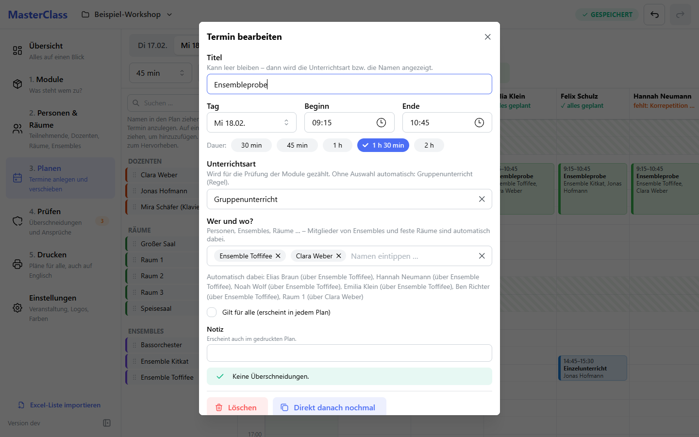

# MasterClass – Stundenpläne für Workshops ohne Überschneidungen

**MasterClass** plant Workshop-Wochenenden, Meisterkurse und Musikcamps: Teilnehmende, Dozentinnen und Dozenten, Räume und Ensembles werden so verplant, dass **niemand doppelt verplant ist**. Am Ende druckt MasterClass für jede Person, jeden Dozenten und jeden Raum einen gut lesbaren Stundenplan – auf Wunsch auch **auf Englisch**.

Entwickelt für das Bavarian Bass Camp, geeignet für jede Art von Kurs mit festen Zeiten.

## ⬇️ Download

| Datei | Wofür? |
|---|---|
| **[MasterClass-Setup.exe (neueste Version)](https://github.com/juliangraf/MasterClass-Releases/releases/latest)** | **Empfohlen.** Installiert MasterClass für Ihr Windows-Benutzerkonto (keine Administratorrechte nötig) und hält es automatisch aktuell. |
| `MasterClass-x.y.z-portable.exe` (auf derselben Seite) | Ohne Installation, z. B. vom USB-Stick. Aktualisiert sich **nicht** selbst. |

Alle Versionen, auch ältere: **[Releases-Seite](https://github.com/juliangraf/MasterClass-Releases/releases)**.
Die Dateien mit `.blockmap` und `latest.yml` braucht nur das Programm für Updates – die müssen Sie nicht herunterladen.

**Voraussetzung:** Windows 10 oder 11 (64 Bit).

> **Windows-Warnung beim ersten Start:** Der Installer ist (noch) nicht signiert. Erscheint „Der Computer wurde durch Windows geschützt“, klicken Sie auf **„Weitere Informationen“ → „Trotzdem ausführen“**.

## Was kann MasterClass?

- **Planen mit der Maus** – Termine im Wochenplan aufziehen, verschieben, in der Länge ändern; Namen aus der Liste in den Plan ziehen.
- **Keine Doppelbuchungen** – Überschneidungen werden sofort rot markiert, auch über Ensembles und feste Räume hinweg, bei Mahlzeiten und bei Abwesenheiten (z. B. spätere Anreise).
- **Module & Ansprüche** – z. B. „Modul 3 = 45 min Einzel + 90 min Gruppe + 45 min Korrepetition“. MasterClass zeigt, wem noch etwas fehlt.
- **Regeln** – Termine zählen automatisch als „Korrepetition“, wenn die Korrepetitorin dabei ist, als „Einzelunterricht“ bei genau einer Teilnehmerin, als „Gruppenunterricht“ ab zwei.
- **Excel-Import** der Anmeldeliste (auch direkt aus Google- oder Microsoft-Formularen), ohne Begleitpersonen, ohne Duplikate.
- **Drucken / PDF** – ein Plan pro Person, Dozent, Raum oder Ensemble, mit Logo, Farben und Sponsoren. MasterClass merkt sich, welche Pläne sich nach dem Druck geändert haben.
- **Pläne auf Englisch** – pro Person einstellbar, für Teilnehmende, die kein Deutsch sprechen.
- **Gemeinsam arbeiten** – die Projektdatei kann in OneDrive, Dropbox, Nextcloud oder Google Drive liegen; Änderungen mehrerer Personen werden zusammengeführt. Funktioniert vollständig offline.
- Automatisches Speichern, Rückgängig/Wiederholen (Strg+Z / Strg+Y), automatische Sicherungskopien.

## 📖 Anleitung

Die ausführliche Schritt-für-Schritt-Anleitung mit Bildern: **[docs/ANLEITUNG.md](docs/ANLEITUNG.md)**

Kurzfassung:

1. **Installieren** und MasterClass starten → „Neues Projekt“ (oder erst einmal „Beispiel ausprobieren“).
2. **Module** festlegen: Was beinhaltet welches Modul? Optional Regeln für die automatische Zuordnung.
3. **Personen & Räume** erfassen – am schnellsten per **Excel-Import** der Anmeldeliste.
4. **Planen**: Termine anlegen, Namen hineinziehen. Rote Termine = Überschneidung.
5. **Prüfen**: Gibt es Überschneidungen? Bekommt jede Person, was ihr laut Modul zusteht?
6. **Drucken** oder als PDF speichern – auf Deutsch oder Englisch.

## Neu in Version 2.1

- Seitenleisten lassen sich einklappen – mehr Platz für den Plan.
- Navigation in der Reihenfolge des Arbeitsablaufs: Module → Personen & Räume → Planen → Prüfen → Drucken.
- Regeln für die automatische Zuordnung von Terminen zu Unterrichtsarten (nach Dozent oder Anzahl der Teilnehmenden).
- Verständlichere Bezeichnungen „Immer mit dabei“ und „Automatisch dabei bei“ (passen für Ensembles, Räume, Dozenten …).
- Im Planer mit Teilnehmenden als Spalten steht im Spaltenkopf, was der Person noch fehlt.
- Pläne auf Englisch (pro Person oder für alle) mit Wörterbuch und Vorschlägen.
- Besserer Excel-Import für Formular-Anmeldelisten: Filter (z. B. ohne Begleitpersonen), lange Modultexte werden erkannt.

## Fragen, Fehler, Wünsche

Bitte ein [Issue](https://github.com/juliangraf/MasterClass-Releases/issues) anlegen oder sich direkt bei der Organisation melden.
Dieses Repository enthält nur die fertigen Programme und die Anleitung, keinen Quellcode.

---

### English summary

**MasterClass** is a Windows app for scheduling workshops and music camps without double bookings: participants, teachers, rooms and ensembles. It imports registration lists from Excel, checks that everyone gets the lessons they booked, and prints a personal timetable for everyone – in German or **English** (set per person).
**Download:** [latest installer](https://github.com/juliangraf/MasterClass-Releases/releases/latest) (`MasterClass-Setup-x.y.z.exe`, no admin rights needed, updates automatically). The user interface is in German; see the [manual (German)](docs/ANLEITUNG.md).
