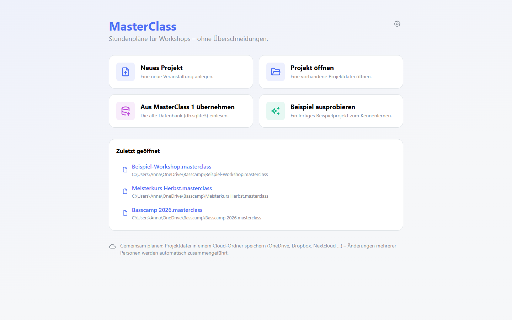
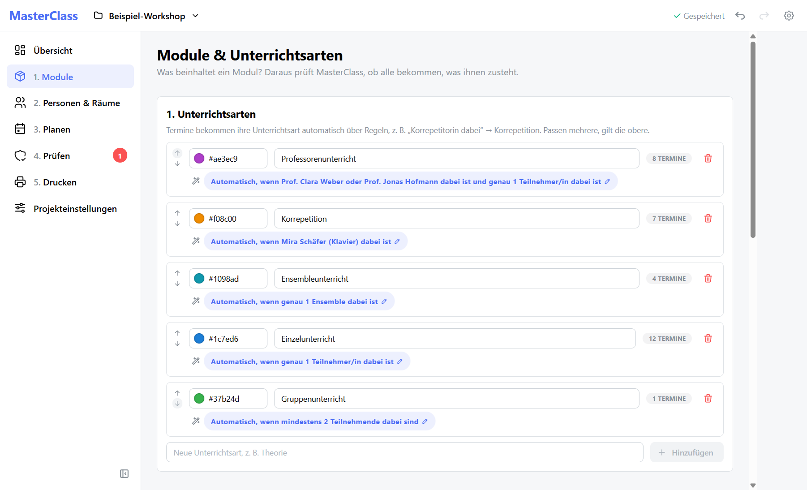
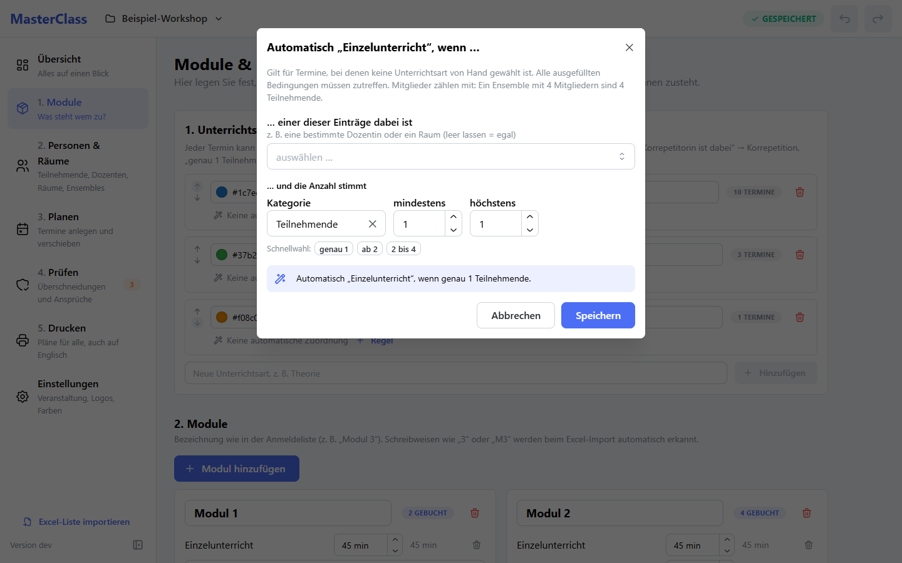
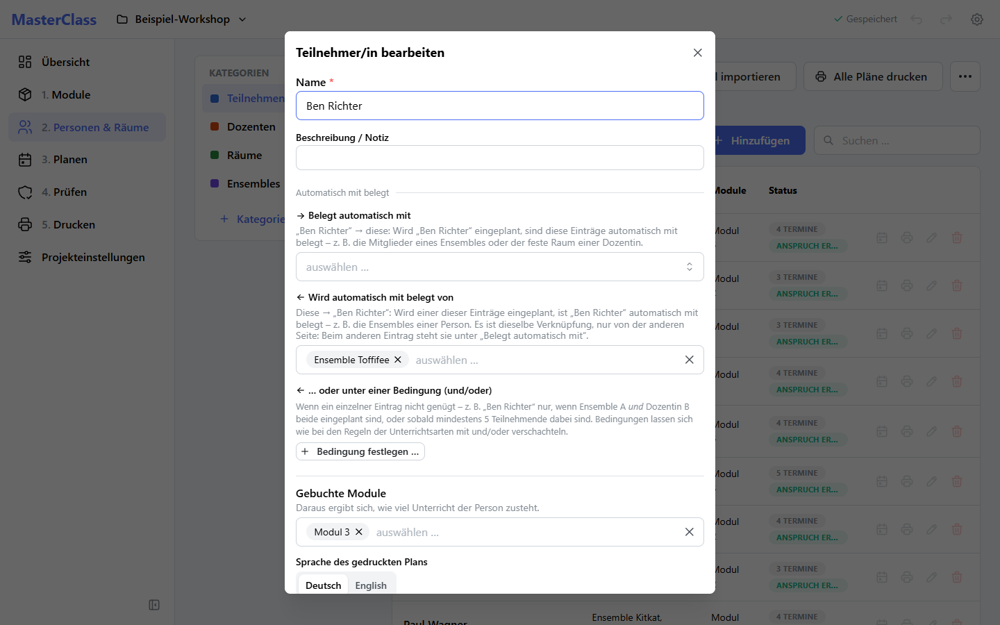
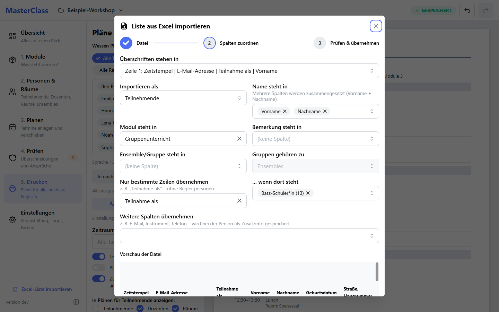
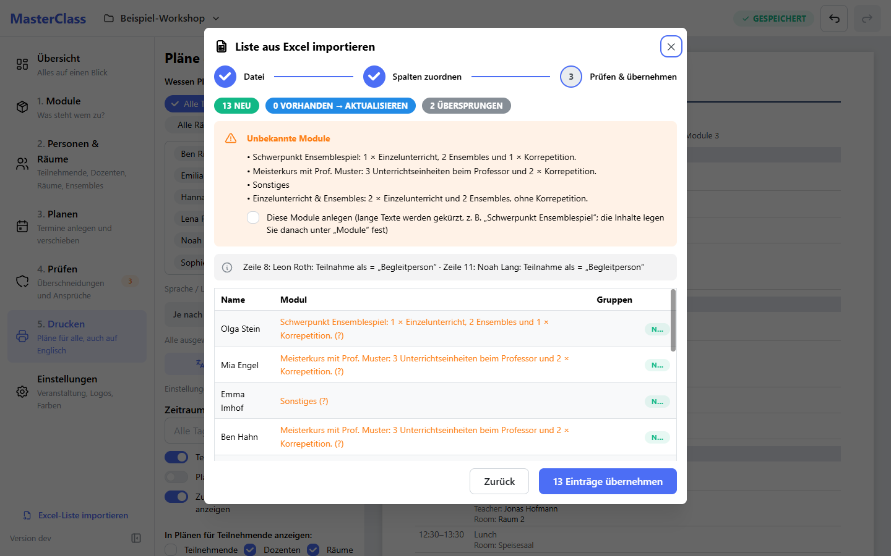
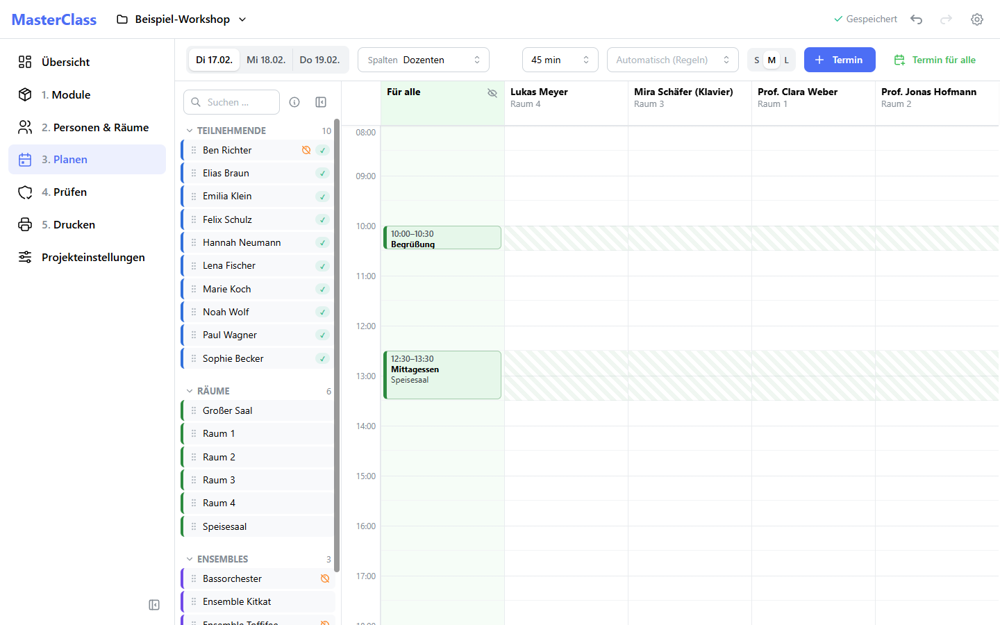
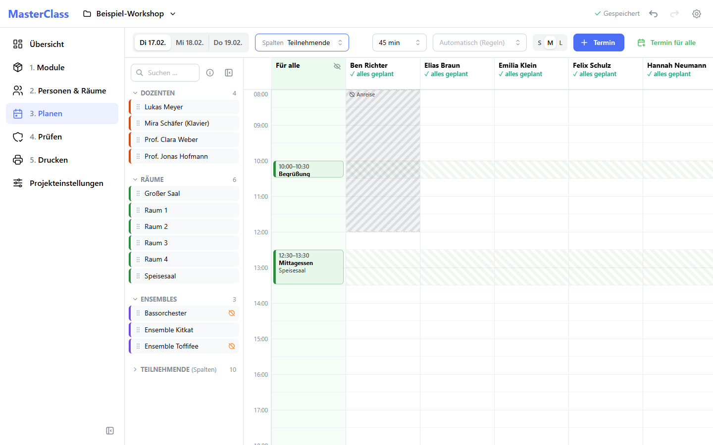

# MasterClass – Anleitung

Diese Anleitung führt Schritt für Schritt durch die Planung einer Veranstaltung – von der Installation bis zum gedruckten Plan.
Alle Bilder zeigen das mitgelieferte Beispielprojekt mit erfundenen Namen.

**Inhalt**

1. [Installation und Updates](#1-installation-und-updates)
2. [Ein Projekt anlegen](#2-ein-projekt-anlegen)
3. [Die Oberfläche](#3-die-oberfläche)
4. [Schritt 1: Module und Unterrichtsarten](#4-schritt-1-module-und-unterrichtsarten)
5. [Schritt 2: Personen, Räume und Ensembles](#5-schritt-2-personen-räume-und-ensembles)
6. [Anmeldeliste aus Excel importieren](#6-anmeldeliste-aus-excel-importieren)
7. [Schritt 3: Planen](#7-schritt-3-planen)
8. [Schritt 4: Prüfen](#8-schritt-4-prüfen)
9. [Schritt 5: Drucken – auch auf Englisch](#9-schritt-5-drucken--auch-auf-englisch)
10. [Einstellungen: Zeitraum, Logo, Farben](#10-einstellungen-zeitraum-logo-farben)
11. [Zu mehreren an einem Plan arbeiten](#11-zu-mehreren-an-einem-plan-arbeiten)
12. [Sichern, Rückgängig, Daten aus MasterClass 1](#12-sichern-rückgängig-daten-aus-masterclass-1)
13. [Häufige Fragen](#13-häufige-fragen)

---

## 1. Installation und Updates

1. Auf der **[Download-Seite](https://github.com/juliangraf/MasterClass-Releases/releases/latest)** unter „Assets“ die Datei **`MasterClass-Setup-x.y.z.exe`** herunterladen (x.y.z ist die Versionsnummer).
2. Die Datei öffnen. Zeigt Windows „Der Computer wurde durch Windows geschützt“, auf **„Weitere Informationen“** und dann **„Trotzdem ausführen“** klicken. (Das Programm ist nicht signiert; die Warnung ist normal.)
3. Installationsordner bestätigen – Administratorrechte sind nicht nötig. Auf dem Desktop erscheint ein Symbol „MasterClass“.

**Updates:** MasterClass prüft bei jedem Start mit Internetverbindung, ob es eine neue Version gibt, lädt sie im Hintergrund und installiert sie beim nächsten Schließen. Sie müssen nichts tun.

**Ohne Installation:** Die Datei `MasterClass-x.y.z-portable.exe` läuft ohne Installation, z. B. vom USB-Stick. Sie aktualisiert sich aber nicht selbst – laden Sie neue Versionen dann von Hand herunter.

**Ältere Versionen** bleiben auf der [Releases-Seite](https://github.com/juliangraf/MasterClass-Releases/releases) erhalten, falls Sie einmal zurück möchten.

## 2. Ein Projekt anlegen

Beim Start haben Sie vier Möglichkeiten:

- **Neues Projekt** – legt eine neue Veranstaltung an. Sie wählen, wo die Projektdatei (`.masterclass`) gespeichert wird. Tipp: in einem Cloud-Ordner, wenn mehrere Personen planen (siehe [Abschnitt 11](#11-zu-mehreren-an-einem-plan-arbeiten)).
- **Projekt öffnen** – eine vorhandene `.masterclass`-Datei öffnen. Ein Doppelklick auf die Datei im Explorer geht auch.
- **Aus MasterClass 1 übernehmen** – die alte Datenbank `db.sqlite3` einlesen.
- **Beispiel ausprobieren** – ein fertiges Beispielprojekt zum Kennenlernen. Hier können Sie alles gefahrlos ausprobieren.

Ein neues Projekt enthält schon sinnvolle Vorgaben: die Kategorien Teilnehmende, Dozenten, Räume und Ensembles sowie die Unterrichtsarten Einzelunterricht, Gruppenunterricht und Korrepetition. Alles lässt sich ändern.

## 3. Die Oberfläche

**Links** ist die Navigation, in der Reihenfolge, in der man normalerweise arbeitet:

| | Seite | Wofür |
|---|---|---|
| | **Übersicht** | Zahlen auf einen Blick, nächste Termine, Checkliste „So geht’s“ |
| 1. | **Module** | Was beinhaltet welches Modul? Regeln für die automatische Zuordnung |
| 2. | **Personen & Räume** | Teilnehmende, Dozenten, Räume, Ensembles erfassen oder importieren |
| 3. | **Planen** | Termine anlegen und verschieben |
| 4. | **Prüfen** | Überschneidungen und offene Ansprüche |
| 5. | **Drucken** | Pläne für alle, auf Deutsch oder Englisch |
| | **Einstellungen** | Zeitraum der Veranstaltung, Logo, Farben, Sponsoren |

Zahlen an „Prüfen“ zeigen Überschneidungen (rot) oder offene Ansprüche (orange); an „Drucken“ die Pläne, die sich seit dem letzten Druck geändert haben.

**Oben** stehen der Projektname (Klick darauf: Speichern unter, Excel-Import, Sicherungskopien, Projekt schließen), der Speicherstatus („Gespeichert“) und die Pfeile für Rückgängig/Wiederholen.

**Mehr Platz:** Mit dem Symbol ganz unten links (▯◂) klappen Sie die Navigation auf schmale Symbole zusammen. Auch die Namensliste im Planer und die Druckeinstellungen lassen sich einklappen. MasterClass merkt sich die Einstellung.

## 4. Schritt 1: Module und Unterrichtsarten

### Unterrichtsarten

Eine **Unterrichtsart** beschreibt, was in einem Termin passiert, z. B. Einzelunterricht, Gruppenunterricht, Korrepetition, Theorie. Farbe und Name können Sie ändern; neue Arten unten hinzufügen.

### Module

Ein **Modul** ist das, was jemand bei der Anmeldung gebucht hat. Sie legen fest, wie viele Minuten welcher Unterrichtsart dazugehören, z. B.:

> **Modul 3** = 45 min Einzelunterricht + 1 h 30 min Gruppenunterricht + 45 min Korrepetition

Unter **„Andere Schreibweisen in Excel-Listen“** tragen Sie ein, wie das Modul in der Anmeldeliste heißt, falls anders (z. B. „Intensiv“). Schreibweisen wie „3“, „M3“ oder „Modul 3“ erkennt MasterClass automatisch.

### Regeln: Termine automatisch zuordnen

Damit ein Termin für die Module zählt, braucht er eine Unterrichtsart. Statt sie bei jedem Termin von Hand zu wählen, können Sie **Regeln** festlegen. Klicken Sie bei einer Unterrichtsart auf **„+ Regel“**:

Eine Regel hat zwei Bedingungen; was Sie leer lassen, ist egal:

- **„… einer dieser Einträge dabei ist“** – z. B. die Korrepetitorin. Dann zählt jeder Termin mit ihr als Korrepetition.
- **„… und die Anzahl stimmt“** – z. B. genau 1 Teilnehmende → Einzelunterricht, ab 2 Teilnehmenden → Gruppenunterricht. Mitglieder eines Ensembles zählen mit: ein Ensemble mit vier Personen sind vier Teilnehmende.

Beispiele für eine typische Einrichtung:

| Unterrichtsart | Regel |
|---|---|
| Korrepetition | Korrepetitorin ist dabei |
| Meisterkurs | Prof. X ist dabei **und** genau 1 Teilnehmende |
| Einzelunterricht | genau 1 Teilnehmende |
| Gruppenunterricht | mindestens 2 Teilnehmende |

**Reihenfolge:** Treffen mehrere Regeln zu, gilt die Unterrichtsart, die weiter oben steht. Mit den kleinen Pfeilen links ändern Sie die Reihenfolge. Im Beispiel oben steht „Korrepetition“ deshalb vor „Einzelunterricht“: eine Teilnehmerin mit der Korrepetitorin ist Korrepetition, kein Einzelunterricht.

**Von Hand hat Vorrang:** Wählen Sie bei einem Termin selbst eine Unterrichtsart, gilt diese. Im Termin steht, welche Unterrichtsart die Regeln ergeben würden („Ohne Auswahl automatisch: …“).

## 5. Schritt 2: Personen, Räume und Ensembles

Links wählen Sie die **Kategorie** (Teilnehmende, Dozenten, Räume, Ensembles …), rechts sehen Sie die Einträge.

- **Schnell hinzufügen:** Namen ins Feld tippen und Enter drücken.
- **Bearbeiten:** Doppelklick auf eine Zeile oder das Stift-Symbol.
- **Weitere Kategorien** (z. B. Instrumente, Korrepetitoren): „Kategorie hinzufügen“. Alles, was nicht gleichzeitig an zwei Orten sein kann, ist eine Kategorie.
- **Kategorie bearbeiten** (Menü „…“): Name in Einzahl und Mehrzahl, Farbe, Reihenfolge, Zusammenführen mit einer anderen Kategorie.

Im Bearbeiten-Fenster:

- **Immer mit dabei** – Einträge, die automatisch mit eingeplant werden, wenn dieser Eintrag eingeplant wird. Beispiele: die Mitglieder eines Ensembles; der feste Raum einer Dozentin.
- **Automatisch dabei bei** – die Gegenrichtung: Wird einer dieser Einträge eingeplant, ist dieser Eintrag automatisch dabei. Beispiele: die Ensembles, in denen eine Person spielt; bei einem Raum die Dozentin, deren fester Raum er ist.

  Plant man also das „Ensemble Toffifee“ ein, sind alle Mitglieder automatisch belegt – und eine Überschneidung mit dem Einzelunterricht eines Mitglieds wird erkannt. Die Bezeichnungen können Sie je Kategorie ändern (z. B. „Mitglieder“ statt „Immer mit dabei“).
- **Gebuchte Module** – daraus ergibt sich, wie viel Unterricht der Person zusteht.
- **Sprache des gedruckten Plans** – **English** für Teilnehmende, die kein Deutsch sprechen (siehe [Abschnitt 9](#9-schritt-5-drucken--auch-auf-englisch)). In der Liste steht dann ein kleines „EN“ hinter dem Namen.
- **Nicht verfügbar** – z. B. spätere Anreise oder früher abreisen. Wird die Person in dieser Zeit eingeplant, meldet MasterClass das.

## 6. Anmeldeliste aus Excel importieren

Statt alle Namen abzutippen, können Sie die Anmeldeliste einlesen – als Excel-Datei (`.xlsx`) oder CSV. Antworten aus **Google Formulare** oder **Microsoft Forms** funktionieren direkt (in Google Tabellen: *Datei → Herunterladen → Microsoft Excel*).

Start: **„Excel-Liste importieren“** unten links, oder auf der Seite „Personen & Räume“ **„Aus Excel importieren“**.

MasterClass erkennt die Spalten meist selbst. Prüfen Sie die Zuordnung:

| Feld | Bedeutung |
|---|---|
| **Überschriften stehen in** | Zeile mit den Spaltenüberschriften (falls oben noch ein Titel steht) |
| **Importieren als** | Kategorie, meist „Teilnehmende“ |
| **Name steht in** | Eine oder mehrere Spalten, z. B. Vorname + Nachname |
| **Modul steht in** | Spalte mit dem gebuchten Modul (bei Formularen oft „Gruppenunterricht“, „Kurs“ o. ä.) |
| **Ensemble/Gruppe steht in** | Spalte mit Ensembles; mehrere durch Komma getrennt. Fehlende Ensembles werden angelegt. |
| **Bemerkung steht in** | Wird als Notiz bei der Person gespeichert |
| **Nur bestimmte Zeilen übernehmen** | z. B. „Teilnahme als“ = „Bass-Schüler*in“ – so werden **Begleitpersonen nicht importiert**. Wird automatisch vorgeschlagen. |
| **Weitere Spalten übernehmen** | z. B. E-Mail, Telefon, Kenntnisse – erscheinen als Zusatzinfo bei der Person |

Im letzten Schritt sehen Sie, wer neu angelegt und wer aktualisiert wird und welche Zeilen übersprungen werden (mit Grund).
**Unbekannte Module:** Kennt MasterClass ein Modul aus der Liste noch nicht, können Sie es mit anlegen lassen. Lange Formulartexte wie „Schwerpunkt Ensemblespiel: 1 × Einzelunterricht, 2 Ensembles …“ werden zu einem Modul „Schwerpunkt Ensemblespiel“; der lange Text wird als Schreibweise gespeichert, damit ein erneuter Import ihn wiedererkennt. Danach unter „Module“ die Minuten eintragen.

**Erneut importieren** (z. B. bei Nachmeldungen) ist unproblematisch: Wer schon da ist (gleicher Name), wird aktualisiert, nicht doppelt angelegt.

## 7. Schritt 3: Planen

Oben wählen Sie den **Tag** und, was die **Spalten** sein sollen – meist Dozenten, aber auch Räume, Ensembles oder Teilnehmende.

**Termine anlegen:**

- In einer Spalte mit der Maus einen Zeitraum **aufziehen** → das Termin-Fenster öffnet sich.
- Einen **Namen aus der Liste links** in den Plan ziehen → Termin mit Spalte + Person, Dauer wie oben eingestellt (z. B. 45 min).
- Einen Namen **auf einen vorhandenen Termin** ziehen → die Person wird hinzugefügt.
- **„+ Termin“** oder **„Termin für alle“** (Mahlzeiten, Konzerte …).

**Ändern:** Termin anklicken (Fenster öffnet sich), ziehen zum Verschieben (auch in eine andere Spalte), am unteren Rand ziehen für die Dauer.

**Unterrichtsart für neue Termine:** Das Feld oben (neben der Dauer). Gibt es Regeln, steht dort „Automatisch (Regeln)“ – dann entscheiden die Regeln.

Im Termin-Fenster sehen Sie sofort, ob es Überschneidungen gibt, und wer **automatisch dabei** ist (z. B. die Mitglieder eines Ensembles, der feste Raum der Dozentin). „Gilt für alle“ lässt den Termin in jedem Plan erscheinen; „In dieser Zeit keine anderen Termine“ macht ihn blockierend (z. B. Mittagessen). Die Notiz erscheint im gedruckten Plan.

**Rote Termine** überschneiden sich mit einem anderen. Die rote Zahl im Spaltenkopf zeigt, wie viele es in dieser Spalte sind.

**Teilnehmende als Spalten:** Wählen Sie oben „Spalten: Teilnehmende“, steht im Kopf jeder Spalte, was der Person laut Modul **noch fehlt** (z. B. „fehlt: Korrepetition 45′“) oder „✓ alles geplant“. Mit der Maus darauf sehen Sie die Details.

**Termine mit zwei Teilnehmenden:** Bei „Spalten: Teilnehmende“ stehen die Teilnehmenden zusätzlich unten in der Namensliste (eingeklappt – auf die Überschrift klicken). Ziehen Sie eine andere Person in die Spalte von Anna, entsteht ein gemeinsamer Termin, der in beiden Spalten erscheint. Ziehen Sie Anna in ihre eigene Spalte, ist es ein Termin nur mit ihr.

**Namensliste:** Anklicken hebt alle Termine dieser Person hervor. Die Gruppen (Dozenten, Räume …) lassen sich über ihre Überschrift auf- und zuklappen. Die Abzeichen zeigen, ob noch Unterricht fehlt (−45′), alles erfüllt ist (✓) oder zu viel geplant ist (+30′). Mit dem Symbol neben dem Suchfeld klappen Sie die Liste ein.

## 8. Schritt 4: Prüfen

Hier sehen Sie alles, was noch nicht stimmt:

- **Überschneidungen** – wer ist wann doppelt verplant, in welchen Terminen? Ein Klick springt zum Termin im Planer.
- **Termine für alle** – Einzeltermine, die in einer blockierenden Zeit (Mahlzeit) liegen.
- **Abwesenheiten** – jemand ist eingeplant, obwohl als nicht verfügbar eingetragen.
- **Ansprüche** – pro Person: Was ist laut Modul vorgesehen, was ist geplant, was fehlt? Als Excel-Datei exportierbar.

## 9. Schritt 5: Drucken – auch auf Englisch

1. **Wessen Pläne?** – z. B. „Alle Teilnehmende“, „Alle Dozenten“ oder einzelne Personen auswählen.
2. **Sprache** – siehe unten.
3. **Einstellungen** – nur ein Tag, Termine für alle ein-/ausblenden, zweispaltig (spart Papier), Zugehörigkeit und Modul im Kopf. Darunter legen Sie fest, welche Namen in den Plänen erscheinen (z. B. in Teilnehmer-Plänen nicht alle anderen Teilnehmenden, der Ensemble-Name reicht).
4. **Drucken** oder **Als PDF speichern**.

Nach dem Drucken merkt sich MasterClass den Stand. Ändert sich später ein Plan, erscheint er hier als „geändert“ – mit **„Nur geänderte auswählen“** drucken Sie beim Umplanen nur die betroffenen Pläne neu.

### Pläne auf Englisch

Unter **Sprache / Language**:

- **Je nach Person** (Standard): Englisch für alle, bei denen im Bearbeiten-Fenster „Plan auf Englisch“ eingestellt ist, Deutsch für alle anderen. So können Sie alle Teilnehmenden in einem Rutsch drucken.
- **Deutsch** / **English**: alle ausgewählten Pläne in dieser Sprache.

Wochentage, Datum und feste Texte werden automatisch übersetzt. **Ihre eigenen Texte** (Termintitel wie „Bassorchester“, Unterrichtsarten, Kategorien, Notizen) übersetzen Sie einmal über **„Englische Übersetzungen …“**:

- Grau angezeigte **Vorschläge** (z. B. Mittagessen → Lunch, Einzelunterricht → Individual lesson, Modul 3 → Module 3) werden automatisch verwendet, solange das Feld leer ist. „Vorschläge übernehmen“ trägt sie fest ein, dann können Sie sie anpassen.
- Ohne Übersetzung bleibt der deutsche Text stehen.
- Die Zahl am Knopf zeigt, wie viele Texte noch weder Übersetzung noch Vorschlag haben. „Nur fehlende“ zeigt genau diese.
- Namen von Personen, Räumen und Ensembles werden nie übersetzt.

## 10. Einstellungen: Zeitraum, Logo, Farben

- **Darstellung** (gilt nur auf diesem Computer):
  - **Farbschema:** Hell, Dunkel oder Wie Windows. Schneller geht es mit dem Sonne/Mond-Knopf oben rechts.
  - **Akzentfarbe** der Oberfläche.
  - **Schriftgröße:** Normal, Groß oder Sehr groß – z. B. für kleine Laptop-Bildschirme.
  - **Termine im Planer:** zarte oder kräftige Farben (kräftig ist z. B. auf dem Beamer besser zu unterscheiden).

  Gedruckte Pläne und die Druckvorschau bleiben immer hell.
- **Veranstaltung:** Name, erster und letzter Tag, sichtbarer Zeitraum im Planer (z. B. 8–22 Uhr), Raster beim Verschieben (z. B. 15 Minuten).
- **Gestaltung der Pläne:** Logo oben, Überschrift, Akzentfarbe, Bild unten (z. B. Sponsoren) mit Text darüber.

## 11. Zu mehreren an einem Plan arbeiten

Legen Sie die Projektdatei in einen gemeinsamen Cloud-Ordner (OneDrive, Dropbox, Nextcloud, Google Drive). Alle öffnen dieselbe Datei.

- MasterClass speichert automatisch und erkennt nach wenigen Sekunden, wenn jemand anderes gespeichert hat.
- Änderungen werden **pro Termin und Feld zusammengeführt** – zwei Personen können gleichzeitig an verschiedenen Terminen arbeiten.
- Haben zwei Personen dasselbe Feld geändert, gewinnt die eigene Änderung, und es erscheint ein Hinweis.
- Ohne Internet arbeiten Sie normal weiter; abgeglichen wird, sobald die Cloud die Datei wieder synchronisiert.

## 12. Sichern, Rückgängig, Daten aus MasterClass 1

- **Rückgängig / Wiederholen:** Strg+Z / Strg+Y oder die Pfeile oben rechts.
- **Speichern:** passiert automatisch; Strg+S speichert sofort.
- **Sicherungskopien:** MasterClass legt automatisch Sicherungen an. Projektname oben → „Sicherungskopien anzeigen“.
- **MasterClass 1:** Startbildschirm → „Aus MasterClass 1 übernehmen“ → die alte `db.sqlite3` wählen (lag meist im Benutzerordner unter `Masterclass`). Die alte Datei wird nicht verändert.

## 13. Häufige Fragen

**Windows warnt beim Installieren.**
Das Programm ist nicht digital signiert. „Weitere Informationen“ → „Trotzdem ausführen“.

**Ein Termin zählt nicht für das Modul.**
Hat der Termin eine Unterrichtsart? Entweder im Termin wählen oder unter „Module“ eine Regel anlegen. „Prüfen“ zeigt Termine ohne Unterrichtsart, an denen Personen mit Modul teilnehmen.

**Eine Person wird im Ensemble-Termin nicht als belegt erkannt.**
Ist sie beim Ensemble unter „Immer mit dabei“ (bzw. bei der Person unter „Automatisch dabei bei“) eingetragen?

**Begleitpersonen wurden mit importiert.**
Beim Import „Nur bestimmte Zeilen übernehmen“ setzen, z. B. Spalte „Teilnahme als“, nur „Schüler*in“ ankreuzen. Bereits importierte Begleitpersonen unter „Personen & Räume“ löschen.

**Der englische Plan enthält noch deutsche Wörter.**
Unter „Drucken“ → „Englische Übersetzungen …“ → „Nur fehlende“ die restlichen Texte übersetzen.

**Kann ich zu einer älteren Version zurück?**
Ja: auf der [Releases-Seite](https://github.com/juliangraf/MasterClass-Releases/releases) die gewünschte Version herunterladen und installieren. Projektdateien neuerer Versionen kann eine ältere Version unter Umständen nicht öffnen – dann erscheint ein Hinweis.
