# MasterClass – Anleitung

Diese Anleitung führt Schritt für Schritt durch die Planung einer Veranstaltung – von der Installation bis zum gedruckten Plan.
Alle Bilder zeigen das mitgelieferte Beispielprojekt mit erfundenen Namen.

**Inhalt**

1. [Installation und Updates](#1-installation-und-updates)
2. [Projekte anlegen, öffnen und wechseln](#2-projekte-anlegen-öffnen-und-wechseln)
3. [Die Oberfläche](#3-die-oberfläche)
4. [Schritt 1: Module und Unterrichtsarten](#4-schritt-1-module-und-unterrichtsarten)
5. [Schritt 2: Personen, Räume und Ensembles](#5-schritt-2-personen-räume-und-ensembles)
6. [Anmeldeliste aus Excel importieren](#6-anmeldeliste-aus-excel-importieren)
7. [Schritt 3: Planen](#7-schritt-3-planen)
8. [Schritt 4: Prüfen](#8-schritt-4-prüfen)
9. [Schritt 5: Drucken – auch auf Englisch](#9-schritt-5-drucken--auch-auf-englisch)
10. [Einstellungen: Programm und Projekt](#10-einstellungen-programm-und-projekt)
11. [Zu mehreren an einem Plan arbeiten](#11-zu-mehreren-an-einem-plan-arbeiten)
12. [Sichern, Rückgängig, Daten aus MasterClass 1](#12-sichern-rückgängig-daten-aus-masterclass-1)
13. [Häufige Fragen](#13-häufige-fragen)

---

## 1. Installation und Updates

1. Auf der **[Download-Seite](https://github.com/juliangraf/MasterClass-Releases/releases/latest)** unter „Assets“ die Datei **`MasterClass-Setup-x.y.z.exe`** herunterladen (x.y.z ist die Versionsnummer).
2. Die Datei öffnen. Zeigt Windows „Der Computer wurde durch Windows geschützt“, auf **„Weitere Informationen“** und dann **„Trotzdem ausführen“** klicken. (Das Programm ist nicht signiert; die Warnung ist normal.)
3. Installationsordner bestätigen – Administratorrechte sind nicht nötig. Auf dem Desktop erscheint ein Symbol „MasterClass“.

**Updates:** MasterClass prüft bei jedem Start mit Internetverbindung (und danach alle paar Stunden), ob es eine neue Version gibt, lädt sie im Hintergrund und installiert sie beim nächsten Schließen. Sie müssen nichts tun. Ist ein Update bereit, erscheint ein Hinweis und ein Punkt am Zahnrad oben rechts; in den [Programmeinstellungen](#programmeinstellungen-zahnrad) können Sie es auch sofort installieren.

**Ohne Installation:** Die Datei `MasterClass-x.y.z-portable.exe` läuft ohne Installation, z. B. vom USB-Stick. Sie aktualisiert sich aber nicht selbst – laden Sie neue Versionen dann von Hand herunter.

**Ältere Versionen** bleiben auf der [Releases-Seite](https://github.com/juliangraf/MasterClass-Releases/releases) erhalten, falls Sie einmal zurück möchten.

## 2. Projekte anlegen, öffnen und wechseln

Jede Veranstaltung ist ein eigenes **Projekt** und liegt in einer eigenen Datei (`.masterclass`), z. B. „Basscamp 2026.masterclass“ und „Basscamp 2027.masterclass“. In der Datei steckt alles: Personen, Termine, Module, Regeln, Gestaltung der Pläne. MasterClass zeigt immer genau ein Projekt an.

### Der Startbildschirm

Ist kein Projekt geöffnet, sehen Sie den Startbildschirm:

- **Neues Projekt** – legt eine neue Veranstaltung an (siehe unten).
- **Projekt öffnen** – eine vorhandene `.masterclass`-Datei auswählen. Ein Doppelklick auf die Datei im Explorer geht auch.
- **Aus MasterClass 1 übernehmen** – die alte Datenbank `db.sqlite3` einlesen (siehe [Abschnitt 12](#12-sichern-rückgängig-daten-aus-masterclass-1)).
- **Beispiel ausprobieren** – ein fertiges Beispielprojekt zum Kennenlernen. Hier können Sie alles gefahrlos ausprobieren.
- **Zuletzt geöffnet** – die letzten zehn Projekte mit Speicherort. Ein Klick öffnet das Projekt. Dateien, die es nicht mehr gibt (gelöscht oder verschoben), verschwinden von selbst aus der Liste.
- Das **Zahnrad** oben rechts öffnet die [Programmeinstellungen](#programmeinstellungen-zahnrad).

### Ein neues Projekt anlegen

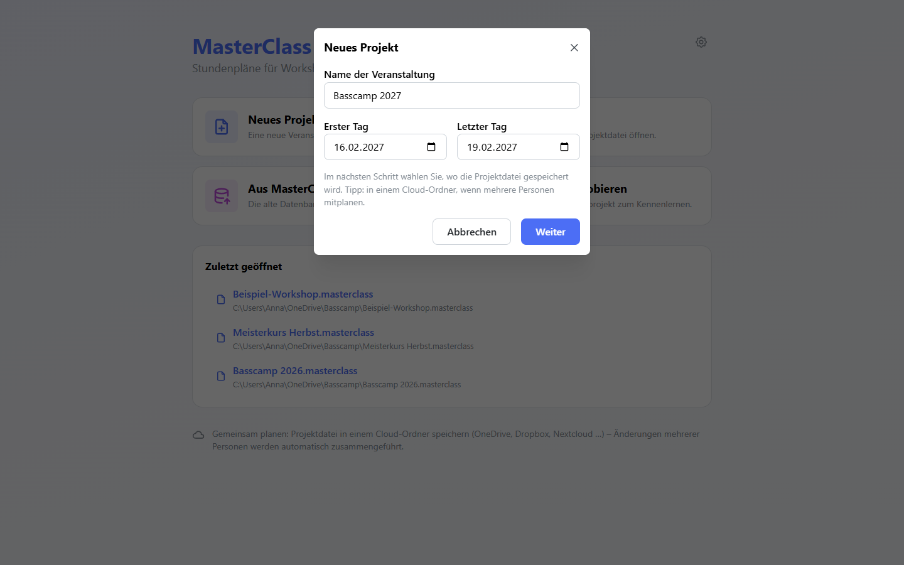

1. Auf dem Startbildschirm **„Neues Projekt“** wählen. (Ist gerade ein Projekt offen: Projektname oben → „Projekt schließen“.)
2. **Name der Veranstaltung** eingeben, z. B. „Basscamp 2027“, sowie **erster und letzter Tag**. Beides lässt sich später in den [Projekteinstellungen](#projekteinstellungen) ändern.
3. **„Weiter“** – Windows fragt nun, **wo die Projektdatei gespeichert** werden soll. Vorgeschlagen ist der Name der Veranstaltung. Planen mehrere Personen mit, wählen Sie einen gemeinsamen Cloud-Ordner (OneDrive, Dropbox, Nextcloud, Google Drive – siehe [Abschnitt 11](#11-zu-mehreren-an-einem-plan-arbeiten)).
4. **„Speichern“** – das Projekt ist sofort offen, Sie landen auf der Übersicht. Ab jetzt speichert MasterClass jede Änderung automatisch in diese Datei.

Ein neues Projekt enthält schon sinnvolle Vorgaben: die Kategorien Teilnehmende, Dozenten, Räume und Ensembles sowie die Unterrichtsarten Einzelunterricht, Gruppenunterricht und Korrepetition. Alles lässt sich ändern. Weiter geht es mit den [Modulen](#4-schritt-1-module-und-unterrichtsarten) und den [Personen](#5-schritt-2-personen-räume-und-ensembles) – die Checkliste „So geht’s“ auf der Übersicht zeigt die Reihenfolge.

### Mit mehreren Projekten arbeiten

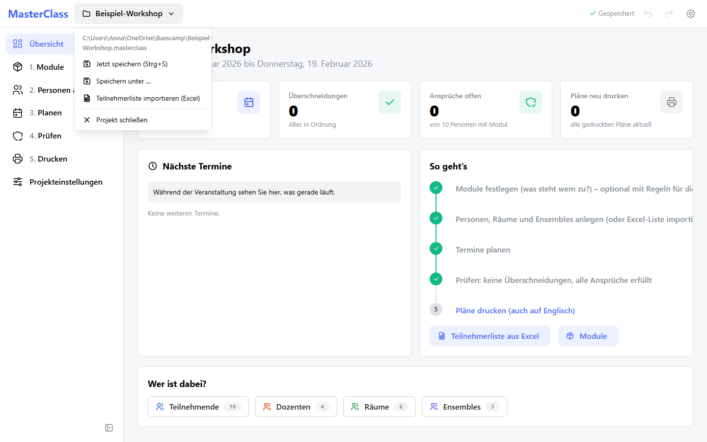

Oben links steht der Name des offenen Projekts. Ein Klick darauf öffnet das **Projektmenü**; ganz oben steht, wo die Datei liegt.

- **Projekt wechseln:** **„Projekt schließen“** – MasterClass speichert und zeigt den Startbildschirm. Dort unter „Zuletzt geöffnet“ das andere Projekt anklicken oder „Projekt öffnen“ wählen.
  Schneller geht es mit einem Doppelklick auf eine andere `.masterclass`-Datei im Explorer: MasterClass speichert das offene Projekt und wechselt direkt. Es öffnet sich kein zweites Fenster.
- **Jetzt speichern (Strg+S)** – speichert sofort. Nötig ist das nicht, MasterClass speichert ohnehin automatisch; oben rechts steht „Gespeichert“.
- **Speichern unter …** – speichert eine **Kopie** unter neuem Namen oder an einem anderen Ort und arbeitet **mit der Kopie** weiter. Die alte Datei bleibt, wie sie war. Praktisch, um aus der Veranstaltung des Vorjahrs die nächste zu machen: „Speichern unter …“ → z. B. „Basscamp 2027“ → in den [Projekteinstellungen](#projekteinstellungen) Name und Tage ändern. Module, Regeln, Räume und Gestaltung bleiben erhalten; auch Personen und Termine werden mitkopiert – was Sie nicht mehr brauchen, löschen Sie danach.
- **Teilnehmerliste importieren (Excel)** – siehe [Abschnitt 6](#6-anmeldeliste-aus-excel-importieren).
- **Sicherungskopien anzeigen** – öffnet den Ordner mit den automatischen Sicherungen (je Projekt ein Unterordner, siehe [Abschnitt 12](#12-sichern-rückgängig-daten-aus-masterclass-1)).

**Gut zu wissen:**

- Eine Projektdatei können Sie im Explorer umbenennen, verschieben oder kopieren, solange sie in MasterClass nicht geöffnet ist. Danach einfach über „Projekt öffnen“ neu auswählen.
- Die [Programmeinstellungen](#programmeinstellungen-zahnrad) (z. B. dunkle Darstellung) gelten für alle Projekte. Alles andere gehört zum jeweiligen Projekt.

## 3. Die Oberfläche

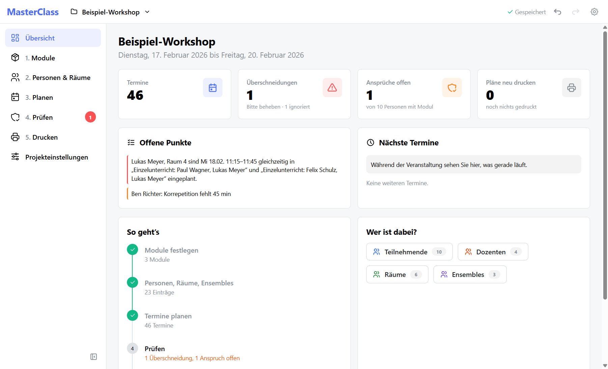

**Links** ist die Navigation, in der Reihenfolge, in der man normalerweise arbeitet:

| | Seite | Wofür |
|---|---|---|
| | **Übersicht** | Zahlen auf einen Blick, nächste Termine, Checkliste „So geht’s“ |
| 1. | **Module** | Was beinhaltet welches Modul? Regeln für die automatische Zuordnung |
| 2. | **Personen & Räume** | Teilnehmende, Dozenten, Räume, Ensembles erfassen oder importieren |
| 3. | **Planen** | Termine anlegen und verschieben |
| 4. | **Prüfen** | Überschneidungen und offene Ansprüche |
| 5. | **Drucken** | Pläne für alle, auf Deutsch oder Englisch |
| | **Projekteinstellungen** | Name und Tage der Veranstaltung, Logo, Farben, Sponsoren |

Zahlen an „Prüfen“ zeigen Überschneidungen (rot) oder offene Ansprüche (orange); an „Drucken“ die Pläne, die sich seit dem letzten Druck geändert haben.

**Oben** stehen der Projektname (Klick darauf öffnet das [Projektmenü](#mit-mehreren-projekten-arbeiten): Speichern unter, Excel-Import, Sicherungskopien, Projekt schließen), der Speicherstatus („Gespeichert“), die Pfeile für Rückgängig/Wiederholen und das Zahnrad für die [Programmeinstellungen](#programmeinstellungen-zahnrad).

**Mehr Platz:** Mit dem Symbol ganz unten links (▯◂) klappen Sie die Navigation auf schmale Symbole zusammen. Auch die Namensliste im Planer und die Druckeinstellungen lassen sich einklappen. MasterClass merkt sich die Einstellung.

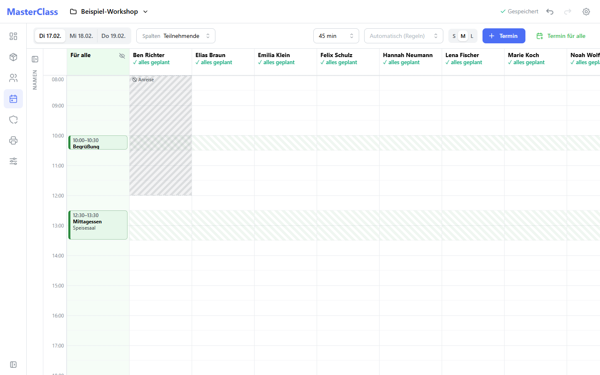

## 4. Schritt 1: Module und Unterrichtsarten

### Unterrichtsarten

Eine **Unterrichtsart** beschreibt, was in einem Termin passiert, z. B. Einzelunterricht, Gruppenunterricht, Korrepetition, Theorie. Farbe und Name können Sie ändern; neue Arten unten hinzufügen.

### Module

Ein **Modul** ist das, was jemand bei der Anmeldung gebucht hat. Sie legen fest, wie viele Minuten welcher Unterrichtsart dazugehören, z. B.:

> **Modul 3** = 45 min Einzelunterricht + 1 h 30 min Gruppenunterricht + 45 min Korrepetition

Unter **„Andere Schreibweisen in Excel-Listen“** tragen Sie ein, wie das Modul in der Anmeldeliste heißt, falls anders (z. B. „Intensiv“). Schreibweisen wie „3“, „M3“ oder „Modul 3“ erkennt MasterClass automatisch.

### Regeln: Termine automatisch zuordnen

Damit ein Termin für die Module zählt, braucht er eine Unterrichtsart. Statt sie bei jedem Termin von Hand zu wählen, können Sie **Regeln** festlegen. Klicken Sie bei einer Unterrichtsart auf **„+ Regel“** (oder auf eine vorhandene Regel, um sie zu ändern):

Eine Regel besteht aus Bedingungen. Es gibt drei Arten:

- **„Dabei ist …“**: einer der ausgewählten Einträge ist beim Termin dabei, z. B. die Korrepetitorin oder einer von zwei Professoren.
- **„Nicht dabei ist …“**: keiner der ausgewählten Einträge ist dabei.
- **„Anzahl“**: so viele Einträge einer Kategorie sind dabei, z. B. genau 1 Teilnehmer/in, ab 2 Teilnehmenden oder genau 1 Ensemble. Mitglieder zählen mit: ein Ensemble mit vier Personen sind vier Teilnehmende; das Bassorchester aus zwei Ensembles sind drei Ensembles.

Oben wählen Sie, wie die Bedingungen verknüpft sind: **„Alle davon (und)“** oder **„Mindestens eine davon (oder)“**. Über **„Bedingung hinzufügen“ → „Gruppe …“** setzen Sie eine Gruppe in die Regel, die selbst wieder „und“ oder „oder“ sein kann – so lässt sich alles beliebig kombinieren. Unter den Bedingungen steht die Regel noch einmal als Satz, z. B. „Automatisch „Bassix“, wenn Bassics und Karola Piel dabei sind.“

Beispiele für eine typische Einrichtung (so ist auch das Beispielprojekt eingerichtet):

| Unterrichtsart | Automatisch, wenn … |
|---|---|
| Professorenunterricht | Prof. A **oder** Prof. B dabei ist **und** genau 1 Teilnehmer/in dabei ist |
| Korrepetition | die Korrepetitorin dabei ist |
| Ensembleunterricht | genau 1 Ensemble dabei ist |
| Einzelunterricht | genau 1 Teilnehmer/in dabei ist |
| Gruppenunterricht | mindestens 2 Teilnehmende dabei sind |

**Reihenfolge:** Treffen mehrere Regeln zu, gilt die Unterrichtsart, die weiter oben steht. Mit den kleinen Pfeilen links ändern Sie die Reihenfolge. Im Beispiel steht „Professorenunterricht“ deshalb vor „Einzelunterricht“: Unterricht bei Prof. A mit einer Person ist Professorenunterricht, Unterricht bei einer anderen Dozentin Einzelunterricht.

### Regeln ändern: Was passiert mit den Terminen?

Regeln gelten immer für alle Termine – auch für die schon geplanten. Bevor Sie eine geänderte Regel speichern, zeigt MasterClass deshalb, was sich ändert:

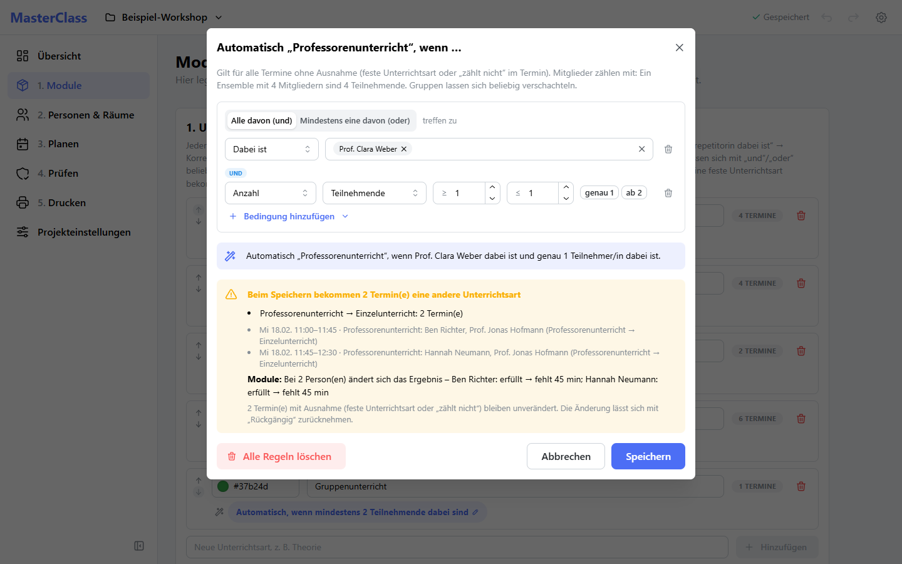

- welche Termine eine andere Unterrichtsart bekommen (z. B. „Professorenunterricht → Einzelunterricht: 2 Termine“),
- bei wem sich das Ergebnis der Module ändert (z. B. „erfüllt → fehlt 45 min“),
- wie viele schon gedruckte Pläne danach neu gedruckt werden müssen.

Termine mit einer **Ausnahme** (siehe unten) ändern sich nicht. Gefällt Ihnen das Ergebnis nicht: „Abbrechen“ – oder nach dem Speichern „Rückgängig“.

Wird eine Person gelöscht, die in einer Regel vorkommt, passt MasterClass die Regel an, ohne ihren Sinn zu verändern. Beispiel: Werden beide Professoren gelöscht, entfällt die Regel „Professorenunterricht“ ganz – sie wird nicht stillschweigend zu „genau 1 Teilnehmer/in“.

### Ausnahmen bei einzelnen Terminen

Manchmal soll ein Termin anders zählen, als die Regeln sagen. Dafür wählen Sie im Termin unter **„Unterrichtsart“**:

- **„Automatisch: …“** – es gelten die Regeln (Standard). Dahinter steht, was die Regeln ergeben.
- **eine feste Unterrichtsart** – z. B. eine Vertretungsstunde bei einem Professor, die trotzdem als Einzelunterricht zählen soll.
- **„Zählt nicht (keine Unterrichtsart)“** – z. B. eine Bühnenprobe, die nicht für die Module zählen soll.

Weicht ein Termin von den Regeln ab, steht das in Orange darunter. Unter „Module“ zeigt die Liste **„Ausnahmen bei einzelnen Terminen“** alle diese Termine; ein Klick auf den Namen öffnet den Termin, **„Aufheben“** lässt ihn wieder den Regeln folgen:

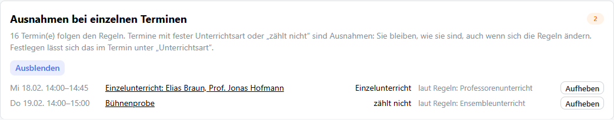

Haben Termine von Hand genau die Unterrichtsart, die sich auch aus den Regeln ergibt (häufig nach dem Übernehmen alter Daten), bietet MasterClass dort an, sie **auf automatisch umzustellen**. Dann folgen sie künftigen Regeländerungen.

## 5. Schritt 2: Personen, Räume und Ensembles

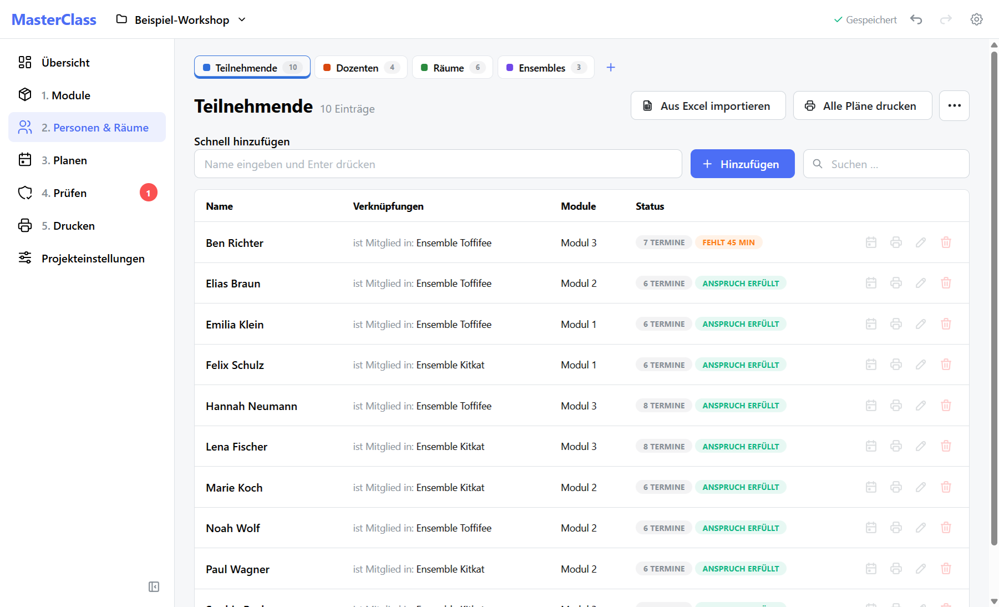

Links wählen Sie die **Kategorie** (Teilnehmende, Dozenten, Räume, Ensembles …), rechts sehen Sie die Einträge.

- **Schnell hinzufügen:** Namen ins Feld tippen und Enter drücken.
- **Bearbeiten:** Doppelklick auf eine Zeile oder das Stift-Symbol.
- **Weitere Kategorien** (z. B. Instrumente, Korrepetitoren): „Kategorie hinzufügen“. Alles, was nicht gleichzeitig an zwei Orten sein kann, ist eine Kategorie.
- **Kategorie bearbeiten** (Menü „…“): Name in Einzahl und Mehrzahl, Farbe, Reihenfolge, Zusammenführen mit einer anderen Kategorie.

Im Bearbeiten-Fenster:

- **Automatisch mit belegt** – hier legen Sie fest, wer mit wem automatisch zusammen eingeplant ist. Das ist *eine* Verknüpfung, die Sie von beiden Seiten aus eintragen können; die Pfeile zeigen die Richtung:
  - **→ Belegt automatisch mit** – wird *dieser* Eintrag eingeplant, sind die ausgewählten automatisch mit belegt. Beispiele: die Mitglieder eines Ensembles; der feste Raum einer Dozentin.
  - **← Wird automatisch mit belegt von** – die Gegenrichtung: wird *einer der ausgewählten* eingeplant, ist dieser Eintrag automatisch mit belegt. Beispiele: die Ensembles, in denen eine Person spielt; bei einem Raum die Dozentin, deren fester Raum er ist.

  Beides ist dasselbe, nur von der anderen Seite gesehen: Tragen Sie beim Ensemble unter „Belegt automatisch mit“ Lisa ein, steht bei Lisa das Ensemble unter „Wird automatisch mit belegt von“. Plant man also das „Ensemble Toffifee“ ein, sind alle Mitglieder automatisch belegt – und eine Überschneidung mit dem Einzelunterricht eines Mitglieds wird erkannt. Die Bezeichnungen können Sie je Kategorie ändern (z. B. „Mitglieder“ statt „Belegt automatisch mit“).
  - **… oder unter einer Bedingung (und/oder)** – für Fälle, in denen ein einzelner Eintrag nicht genügt. Über **„Bedingung festlegen …“** öffnet sich derselbe Editor wie bei den [Regeln der Unterrichtsarten](#regeln-termine-automatisch-zuordnen). Beispiele: Der Pianoraum ist nur dann automatisch belegt, wenn Ensemble A **und** Dozentin B beide eingeplant sind; die Korrepetitorin kommt automatisch dazu, wenn mindestens 5 Teilnehmende dabei sind. So müssen Sie nicht für jede Kombination einzeln etwas eintragen. Die Bedingung steht danach als Satz im Fenster und in der Liste. Sie gilt nicht für Termine, die für alle gelten.

  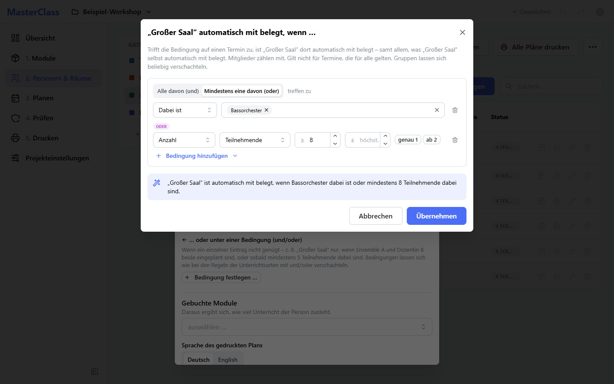
- **Gebuchte Module** – daraus ergibt sich, wie viel Unterricht der Person zusteht.
- **Sprache des gedruckten Plans** – **English** für Teilnehmende, die kein Deutsch sprechen (siehe [Abschnitt 9](#9-schritt-5-drucken--auch-auf-englisch)). In der Liste steht dann ein kleines „EN“ hinter dem Namen.
- **Nicht verfügbar** – z. B. spätere Anreise oder früher abreisen, mit Grund. Im Planer ist diese Zeit [schraffiert](#7-schritt-3-planen); wird die Person trotzdem eingeplant, meldet MasterClass das.

## 6. Anmeldeliste aus Excel importieren

Statt alle Namen abzutippen, können Sie die Anmeldeliste einlesen – als Excel-Datei (`.xlsx`) oder CSV. Antworten aus **Google Formulare** oder **Microsoft Forms** funktionieren direkt (in Google Tabellen: *Datei → Herunterladen → Microsoft Excel*).

Start: **„Excel-Liste importieren“** unten links, oder auf der Seite „Personen & Räume“ **„Aus Excel importieren“**.

MasterClass erkennt die Spalten meist selbst. Prüfen Sie die Zuordnung:

| Feld | Bedeutung |
|---|---|
| **Überschriften stehen in** | Zeile mit den Spaltenüberschriften (falls oben noch ein Titel steht) |
| **Importieren als** | Kategorie, meist „Teilnehmende“ |
| **Name steht in** | Eine oder mehrere Spalten, z. B. Vorname + Nachname |
| **Modul steht in** | Spalte mit dem gebuchten Modul (bei Formularen oft „Gruppenunterricht“, „Kurs“ o. ä.) |
| **Ensemble/Gruppe steht in** | Spalte mit Ensembles; mehrere durch Komma getrennt. Fehlende Ensembles werden angelegt. |
| **Bemerkung steht in** | Wird als Notiz bei der Person gespeichert |
| **Nur bestimmte Zeilen übernehmen** | z. B. „Teilnahme als“ = „Bass-Schüler*in“ – so werden **Begleitpersonen nicht importiert**. Wird automatisch vorgeschlagen. |
| **Weitere Spalten übernehmen** | z. B. E-Mail, Telefon, Kenntnisse – erscheinen als Zusatzinfo bei der Person |

Im letzten Schritt sehen Sie, wer neu angelegt und wer aktualisiert wird und welche Zeilen übersprungen werden (mit Grund).
**Unbekannte Module:** Kennt MasterClass ein Modul aus der Liste noch nicht, können Sie es mit anlegen lassen. Lange Formulartexte wie „Schwerpunkt Ensemblespiel: 1 × Einzelunterricht, 2 Ensembles …“ werden zu einem Modul „Schwerpunkt Ensemblespiel“; der lange Text wird als Schreibweise gespeichert, damit ein erneuter Import ihn wiedererkennt. Danach unter „Module“ die Minuten eintragen.

**Erneut importieren** (z. B. bei Nachmeldungen) ist unproblematisch: Wer schon da ist (gleicher Name), wird aktualisiert, nicht doppelt angelegt.

## 7. Schritt 3: Planen

Oben wählen Sie den **Tag** und, was die **Spalten** sein sollen – meist Dozenten, aber auch Räume, Ensembles oder Teilnehmende.

**Termine anlegen:**

- In einer Spalte mit der Maus einen Zeitraum **aufziehen** → das Termin-Fenster öffnet sich.
- Einen **Namen aus der Liste links** in den Plan ziehen → Termin mit Spalte + Person, Dauer wie oben eingestellt (z. B. 45 min).
- Einen Namen **auf einen vorhandenen Termin** ziehen → die Person wird hinzugefügt.
- **„+ Termin“** oder **„Termin für alle“** (Kalender mit Plus – für Mahlzeiten, Konzerte …).

**Ändern:** Termin anklicken (Fenster öffnet sich), ziehen zum Verschieben (auch in eine andere Spalte), am unteren Rand ziehen für die Dauer.

**Unterrichtsart für neue Termine:** Das Feld oben (neben der Dauer). Gibt es Regeln, steht dort „Automatisch (Regeln)“ – dann entscheiden die Regeln. Ausnahmen für einzelne Termine legen Sie im Termin fest (siehe [Ausnahmen](#ausnahmen-bei-einzelnen-terminen)).

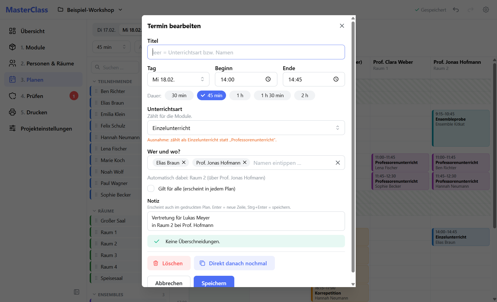

Im Termin-Fenster sehen Sie sofort, ob es Überschneidungen gibt, und wer **automatisch dabei** ist (z. B. die Mitglieder eines Ensembles, der feste Raum der Dozentin). „Gilt für alle“ lässt den Termin in jedem Plan erscheinen; „In dieser Zeit keine anderen Termine“ macht ihn blockierend (z. B. Mittagessen). Die Notiz erscheint im gedruckten Plan.

**Rote Termine** überschneiden sich mit einem anderen. Die rote Zahl im Spaltenkopf zeigt, wie viele es in dieser Spalte sind.

**Spalte „Für alle“:** Ganz links stehen die Termine, die für alle gelten (Mahlzeiten, Begrüßung, Konzert). In den anderen Spalten sind sie als grün gestreiftes Band zu sehen. Brauchen Sie den Platz, blenden Sie die Spalte mit dem durchgestrichenen Auge im Spaltenkopf aus. Dann stehen Uhrzeit und Titel dieser Termine direkt in den Bändern der anderen Spalten; ein Klick darauf öffnet den Termin. Der grüne Knopf mit der Weltkugel oben links in der Ecke blendet die Spalte wieder ein. MasterClass merkt sich die Einstellung. Neue Termine für alle legen Sie weiterhin mit **„Termin für alle“** an.

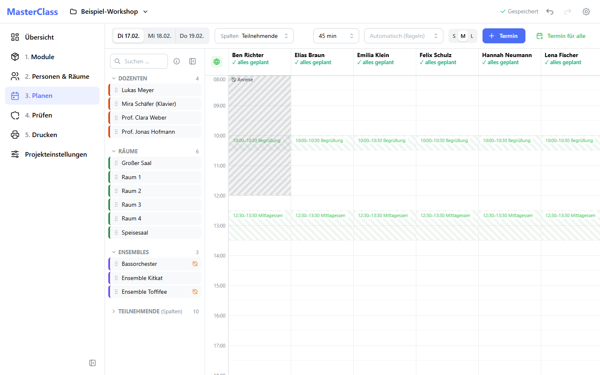

**Abwesenheiten:** Ist jemand zeitweise nicht verfügbar (eingetragen bei der Person unter [„Nicht verfügbar“](#5-schritt-2-personen-räume-und-ensembles), z. B. spätere Anreise), sehen Sie das beim Planen sofort:

- In der **Spalte der Person** (bzw. einer Gruppe, zu der sie gehört) ist die Zeit grau schraffiert, mit dem Grund oben im Band. Mit der Maus darauf stehen Uhrzeit und Grund.
- In der **Namensliste** steht eine durchgestrichene Uhr (orange) bei allen, die an diesem Tag ganz oder teilweise fehlen – bei einer Gruppe auch, wenn ein Mitglied fehlt. Mit der Maus darauf sehen Sie, wer wann fehlt.
- Klicken Sie einen Namen in der Liste an oder ziehen Sie ihn gerade in den Plan, erscheint seine Abwesenheit **orange in allen Spalten** – so sehen Sie auch in der Dozenten-Ansicht, wann eine Teilnehmerin nicht kann.
- Wird jemand trotzdem in dieser Zeit eingeplant, meldet MasterClass „Nicht verfügbar!“, und unter „Prüfen“ steht es bei den Abwesenheiten.

**Teilnehmende als Spalten:** Wählen Sie oben „Spalten: Teilnehmende“, steht im Kopf jeder Spalte, was der Person laut Modul **noch fehlt** (z. B. „fehlt: Korrepetition 45′“) oder „✓ alles geplant“. Mit der Maus darauf sehen Sie die Details. Im Bild reist Ben Richter erst mittags an – seine Spalte ist bis 12 Uhr schraffiert.

**Termine mit zwei Teilnehmenden:** Bei „Spalten: Teilnehmende“ stehen die Teilnehmenden zusätzlich unten in der Namensliste (eingeklappt – auf die Überschrift klicken). Ziehen Sie eine andere Person in die Spalte von Anna, entsteht ein gemeinsamer Termin, der in beiden Spalten erscheint. Ziehen Sie Anna in ihre eigene Spalte, ist es ein Termin nur mit ihr.

**Namensliste:** Anklicken hebt alle Termine dieser Person hervor. Die Gruppen (Dozenten, Räume …) lassen sich über ihre Überschrift auf- und zuklappen. Die Abzeichen zeigen, ob noch Unterricht fehlt (−45′), alles erfüllt ist (✓) oder zu viel geplant ist (+30′). Mit dem Symbol neben dem Suchfeld klappen Sie die Liste ein.

## 8. Schritt 4: Prüfen

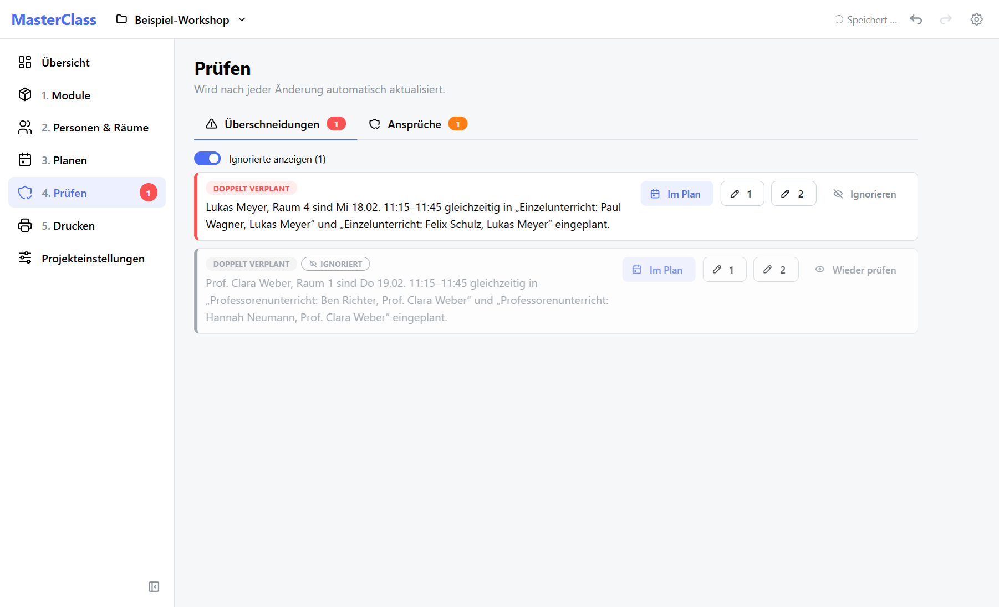

Hier sehen Sie alles, was noch nicht stimmt:

- **Überschneidungen** – wer ist wann doppelt verplant, in welchen Terminen? Ein Klick springt zum Termin im Planer.
- **Termine für alle** – Einzeltermine, die in einer blockierenden Zeit (Mahlzeit) liegen.
- **Abwesenheiten** – jemand ist eingeplant, obwohl als nicht verfügbar eingetragen.
- **Ansprüche** – pro Person: Was ist laut Modul vorgesehen, was ist geplant, was fehlt? Als Excel-Datei exportierbar.

## 9. Schritt 5: Drucken – auch auf Englisch

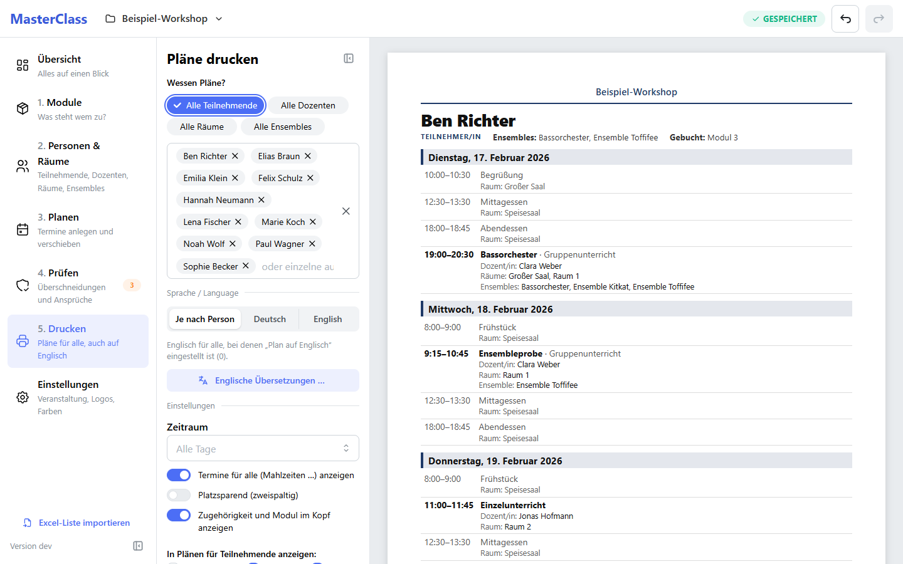

1. **Wessen Pläne?** – z. B. „Alle Teilnehmende“, „Alle Dozenten“ oder einzelne Personen auswählen.
2. **Sprache** – siehe unten.
3. **Einstellungen** – nur ein Tag, Termine für alle ein-/ausblenden, zweispaltig (spart Papier), Zugehörigkeit und Modul im Kopf. Darunter legen Sie fest, welche Namen in den Plänen erscheinen (z. B. in Teilnehmer-Plänen nicht alle anderen Teilnehmenden, der Ensemble-Name reicht).
4. **Drucken** oder **Als PDF speichern**.

Nach dem Drucken merkt sich MasterClass den Stand. Ändert sich später ein Plan, erscheint er hier als „geändert“ – mit **„Nur geänderte auswählen“** drucken Sie beim Umplanen nur die betroffenen Pläne neu.

### Pläne auf Englisch

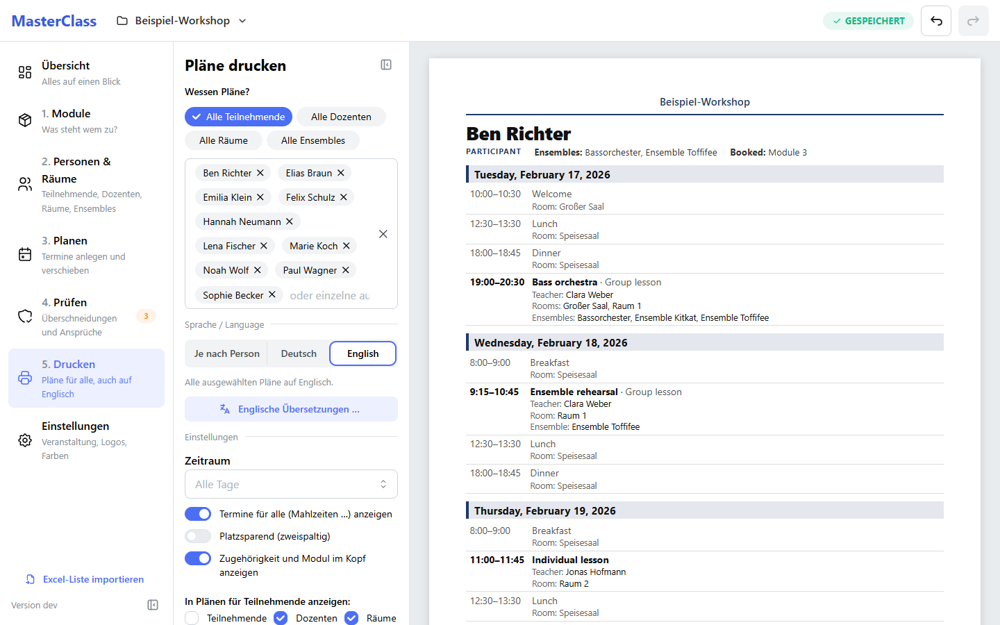

Unter **Sprache / Language**:

- **Je nach Person** (Standard): Englisch für alle, bei denen im Bearbeiten-Fenster „Plan auf Englisch“ eingestellt ist, Deutsch für alle anderen. So können Sie alle Teilnehmenden in einem Rutsch drucken.
- **Deutsch** / **English**: alle ausgewählten Pläne in dieser Sprache.

Wochentage, Datum und feste Texte werden automatisch übersetzt. **Ihre eigenen Texte** (Termintitel wie „Bassorchester“, Unterrichtsarten, Kategorien, Notizen) übersetzen Sie einmal über **„Englische Übersetzungen …“**:

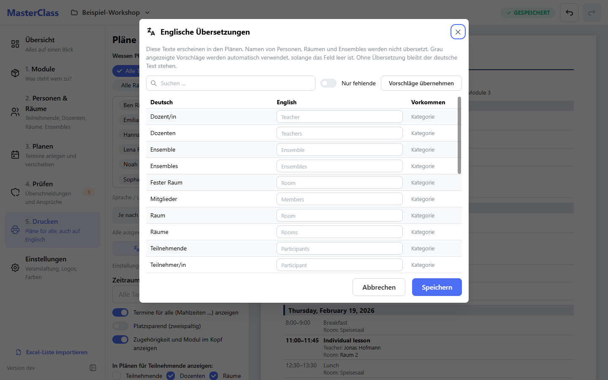

- Grau angezeigte **Vorschläge** (z. B. Mittagessen → Lunch, Einzelunterricht → Individual lesson, Modul 3 → Module 3) werden automatisch verwendet, solange das Feld leer ist. „Vorschläge übernehmen“ trägt sie fest ein, dann können Sie sie anpassen.
- Ohne Übersetzung bleibt der deutsche Text stehen.
- Die Zahl am Knopf zeigt, wie viele Texte noch weder Übersetzung noch Vorschlag haben. „Nur fehlende“ zeigt genau diese.
- Namen von Personen, Räumen und Ensembles werden nie übersetzt.

## 10. Einstellungen: Programm und Projekt

Es gibt zwei Arten von Einstellungen:

| | Wo? | Gilt für |
|---|---|---|
| **Programmeinstellungen** | Zahnrad oben rechts (auch auf dem Startbildschirm) | diesen Computer, alle Projekte |
| **Projekteinstellungen** | links in der Navigation | nur dieses Projekt – wird in der Projektdatei gespeichert und gilt damit für alle, die mitplanen |

### Programmeinstellungen (Zahnrad)

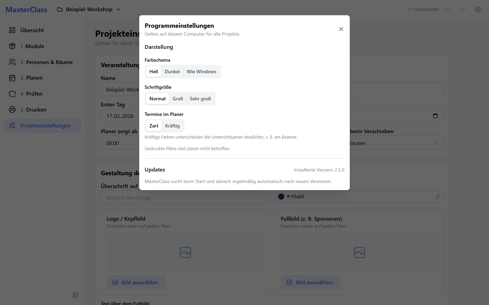

- **Farbschema:** Hell, Dunkel oder Wie Windows (folgt der Windows-Einstellung).
- **Schriftgröße:** Normal, Groß oder Sehr groß – z. B. für kleine Laptop-Bildschirme oder den Beamer.
- **Termine im Planer:** zarte oder kräftige Farben. Kräftige Farben unterscheiden die Unterrichtsarten deutlicher, z. B. am Beamer.
- **Updates:** zeigt die installierte Version. **„Nach Updates suchen“** prüft sofort (sonst passiert das automatisch). Ist eine neue Version heruntergeladen, installiert **„Jetzt neu starten und installieren“** sie sofort – das Projekt wird vorher gespeichert. Ohne diesen Knopf wird sie beim nächsten Schließen installiert. Die portable Version aktualisiert sich nicht selbst.

Gedruckte Pläne und die Druckvorschau bleiben immer hell – die Darstellung betrifft nur den Bildschirm.

### Projekteinstellungen

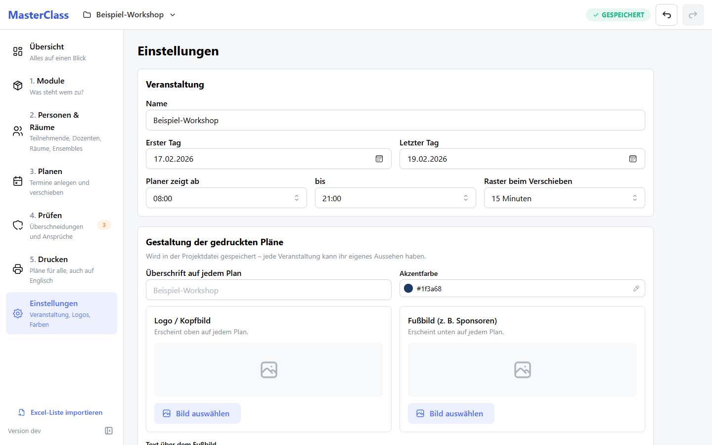

- **Veranstaltung:** Name, erster und letzter Tag, sichtbarer Zeitraum im Planer (z. B. 8–21 Uhr) und das Raster beim Verschieben (5, 15 oder 30 Minuten).
- **Gestaltung der gedruckten Pläne:** Überschrift auf jedem Plan (Standard: Name der Veranstaltung), Farbe der Überschriften, Logo oben, Bild unten (z. B. Sponsoren) mit Text darüber. Bilder werden beim Einfügen verkleinert, damit die Projektdatei klein bleibt.
- **Projektdatei:** wo die Datei liegt, und **„Sicherungskopien öffnen“**.

## 11. Zu mehreren an einem Plan arbeiten

Legen Sie die Projektdatei in einen gemeinsamen Cloud-Ordner (OneDrive, Dropbox, Nextcloud, Google Drive). Alle öffnen dieselbe Datei.

- MasterClass speichert automatisch und erkennt nach wenigen Sekunden, wenn jemand anderes gespeichert hat.
- Änderungen werden **pro Termin und Feld zusammengeführt** – zwei Personen können gleichzeitig an verschiedenen Terminen arbeiten.
- Haben zwei Personen dasselbe Feld geändert, gewinnt die eigene Änderung, und es erscheint ein Hinweis.
- Ohne Internet arbeiten Sie normal weiter; abgeglichen wird, sobald die Cloud die Datei wieder synchronisiert.

## 12. Sichern, Rückgängig, Daten aus MasterClass 1

- **Rückgängig / Wiederholen:** Strg+Z / Strg+Y oder die Pfeile oben rechts.
- **Speichern:** passiert automatisch; Strg+S speichert sofort.
- **Sicherungskopien:** MasterClass legt automatisch Sicherungen an. Projektname oben → „Sicherungskopien anzeigen“ (oder Projekteinstellungen → „Sicherungskopien öffnen“). Beim Speichern entsteht höchstens alle 5 Minuten eine Sicherung; je Projekt bleiben die letzten 40 erhalten, mit Datum und Uhrzeit im Dateinamen. **Zurückholen:** die gewünschte Sicherung im Explorer an einen eigenen Ort kopieren (z. B. neben die Projektdatei) und dort über „Projekt öffnen“ öffnen.
- **MasterClass 1:** Startbildschirm → „Aus MasterClass 1 übernehmen“ → die alte `db.sqlite3` wählen (lag meist im Benutzerordner unter `Masterclass`). Die alte Datei wird nicht verändert.

## 13. Häufige Fragen

**Windows warnt beim Installieren.**
Das Programm ist nicht digital signiert. „Weitere Informationen“ → „Trotzdem ausführen“.

**Ein Termin zählt nicht für das Modul.**
Hat der Termin eine Unterrichtsart? Entweder im Termin wählen oder unter „Module“ eine Regel anlegen. Steht im Termin „Zählt nicht“, ist er absichtlich ausgenommen. „Prüfen“ zeigt Termine ohne Unterrichtsart, an denen Personen mit Modul teilnehmen.

**Ein Termin zählt als falsche Unterrichtsart.**
Im Termin unter „Unterrichtsart“ steht, was die Regeln ergeben. Trifft eine weiter oben stehende Regel zu, gewinnt sie – Reihenfolge unter „Module“ ändern oder die Regel genauer fassen. Für einen einzelnen Termin genügt eine Ausnahme (feste Unterrichtsart im Termin).

**Eine Person wird im Ensemble-Termin nicht als belegt erkannt.**
Ist sie beim Ensemble unter „Belegt automatisch mit“ (bzw. bei der Person unter „Wird automatisch mit belegt von“) eingetragen? Im Termin-Fenster steht unter „Automatisch dabei“, wer über eine Verknüpfung oder Bedingung mit belegt ist.

**Begleitpersonen wurden mit importiert.**
Beim Import „Nur bestimmte Zeilen übernehmen“ setzen, z. B. Spalte „Teilnahme als“, nur „Schüler*in“ ankreuzen. Bereits importierte Begleitpersonen unter „Personen & Räume“ löschen.

**Der englische Plan enthält noch deutsche Wörter.**
Unter „Drucken“ → „Englische Übersetzungen …“ → „Nur fehlende“ die restlichen Texte übersetzen.

**Kann ich zu einer älteren Version zurück?**
Ja: auf der [Releases-Seite](https://github.com/juliangraf/MasterClass-Releases/releases) die gewünschte Version herunterladen und installieren. Projektdateien neuerer Versionen kann eine ältere Version unter Umständen nicht öffnen – dann erscheint ein Hinweis.
